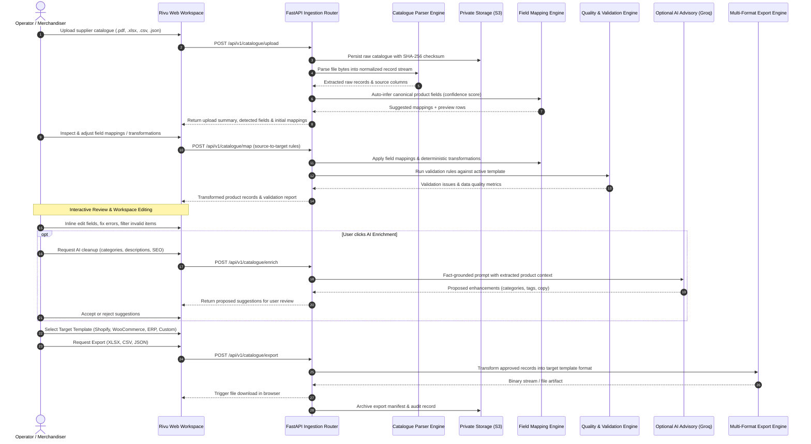

# Rivu AI — Data Flow Specification

**Product:** Rivu AI by WaterTing  
**Workflow:** Supplier Catalogue Ingestion → Refinement → Product Export  

---

## 1. End-to-End Workflow Diagram



---

## 2. Stage Details & Data Transformations

### Stage 1: File Upload & Ingestion
- **Input:** Raw binary bytes of uploaded file (HTTP multipart).
- **Validation:**
  - File extension verification (`.pdf`, `.xlsx`, `.xls`, `.csv`, `.json`).
  - Size check (configured maximum 500 MB).
  - Binary signature check (ZIP signature for XLSX, OLE for XLS, `%PDF-` header for PDF).
- **Storage:** Persisted to `orgs/{org_id}/catalogues/{catalogue_id}/source/{filename}`.
- **Output:** Raw tabular data structure: List of dicts representing raw source rows, with `_source_row_index` tracked for every entry.

### Stage 2: Schema Inference & Field Mapping
- **Input:** Raw column names (e.g., `Part #`, `Item Description`, `List Price`, `Qty Available`, `Pkg Wt (lbs)`).
- **Inference Logic:**
  - Standard dictionary matching with aliases.
  - Levenshtein string similarity against standard target fields.
  - Data sample inspection (detecting numeric currencies, URL patterns, integers).
- **Mapping Specification:**
  ```json
  {
    "mappings": [
      { "source_column": "Part #", "target_field": "sku", "confidence": 0.95 },
      { "source_column": "Item Description", "target_field": "name", "confidence": 0.90 },
      { "source_column": "List Price", "target_field": "price", "transform": "currency_to_decimal", "confidence": 0.98 },
      { "source_column": "Qty Available", "target_field": "stock_quantity", "transform": "to_integer", "confidence": 0.95 }
    ]
  }
  ```

### Stage 3: Normalization & Validation
- **Input:** Mapped records.
- **Normalization:**
  - Prices converted to float with 2 decimal precision.
  - Currencies isolated.
  - Whitespace trimmed.
  - SKU stripped of non-printable characters and uppercase normalized.
- **Validation Rules:**
  - Check missing required fields.
  - Duplicate SKU detection across the batch.
  - Price validity ($ > 0.00).
- **Output:** Canonical Product Records with status (`valid`, `warning`, `error`) and structured issue objects.

### Stage 4: Workspace Editing & User Approval
- User can search, sort, filter by issue severity (`All`, `Errors only`, `Warnings only`, `Valid only`).
- User can perform inline cell edits, add products, duplicate rows, or delete junk rows.
- Unsaved changes indicator prevents accidental navigation data loss.

### Stage 5: Export Serialization
- **Shopify Template:** Formats Handles (kebab-cased from product title), HTML-formatted descriptions, Variant pricing, and Shopify-compatible column headers.
- **WooCommerce Template:** Maps Regular Price, Stock status (`instock`/`outofstock`), and image galleries.
- **Standard E-Commerce / Universal:** Complete flat or structured schema.
- **File Serialization:**
  - **XLSX:** Multi-column Excel with typed cells (numeric price, integer stock).
  - **CSV:** Quoted, UTF-8 encoded with standard CRLF or LF line endings.
  - **JSON:** Pretty-printed JSON array.
