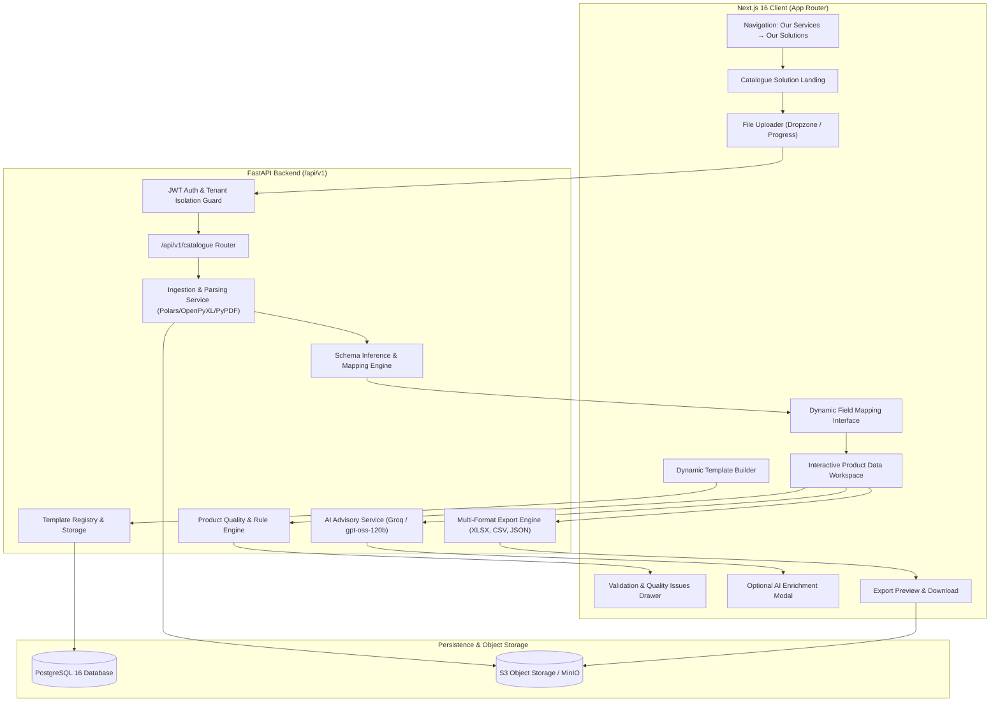

# Rivu AI — System Architecture & Component Specification

**Product:** Rivu AI by WaterTing  
**System:** AI Data Refinery & Dynamic Catalogue-to-Product Data Entry  
**Specification Level:** Production Engineering  

---

## 1. Architectural Principles

1. **Reuse Existing Infrastructure:** Work strictly within Next.js 16 (App Router) and FastAPI. Use existing PostgreSQL models, S3 object storage client, and JWT authentication.
2. **Immutable Source Preserved:** The original supplier catalogue (whether PDF, XLSX, CSV, or JSON) is stored with SHA-256 checksum in private object storage and never modified.
3. **Deterministic Core vs. Advisory AI:** Data normalization, type coercion, field mapping, SKU validation, and price conversions are 100% deterministic and testable. AI is an optional advisory layer (e.g. grammar correction, category recommendation, SEO enrichment).
4. **Tenant Isolation:** Every dataset, product workspace, template, and export is strictly bound to `user.active_org_id` and verified at the API layer with database-level ownership filtering.
5. **Fast Feedback & Responsiveness:** Interactive client-side workspace allows live edits, instant validation feedback, dynamic mapping recomputation, and live export previews.

---

## 2. High-Level System Architecture Diagram

---

## 3. Subsystem Breakdown

### 3.1 Catalogue Ingestion Subsystem (`backend/app/catalogue/parser.py`)
- **Format Auto-Detection:** Detects `.csv`, `.xlsx`, `.xls`, `.json`, and `.pdf`.
- **PDF Extraction Engine:**
  - Extracts tabular text blocks and line structures from vector and text-based supplier catalogues using `pypdf`.
  - Distinguishes header blocks from tabular repeating product rows.
  - Handles multi-page price lists, product catalogs, and spec sheets.
- **Excel & CSV Engine:**
  - Enumerate sheets, auto-detect header row, strip whitespace, handle duplicate/empty headers gracefully.
  - Retains raw unparsed row indices for auditability.
- **JSON Engine:**
  - Supports lists of records or nested objects with deterministic path flattening (`attributes.color` -> `attributes_color`).

### 3.2 Dynamic Mapping & Normalization Engine (`backend/app/catalogue/mapping.py`)
- Maps arbitrary supplier headers into the canonical Product Model.
- **Rule-based Auto-Inference:**
  - Confidence scoring using fuzzy string matching (Levenshtein distance) and semantic synonyms (e.g., "Item Name", "Title", "Product Description", "SKU", "Part Number", "Item Code", "MSRP", "Retail Price", "Cost", "Stock", "Qty", "Inventory").
- **Transformation Pipeline:**
  - Strip leading/trailing whitespace.
  - Parse currency symbols (`$`, `€`, `£`, `₹`) and normalize prices to decimal numbers.
  - Case normalization (UPPERCASE SKU, Title Case product name, lowercase category slugs).
  - Unit normalization (e.g. `10 kg` -> `weight: 10`, `unit: kg`).

### 3.3 Canonical Product Model (`backend/app/catalogue/models.py`)
A comprehensive, e-commerce and ERP ready schema:
- `id` (UUID / internal string)
- `name` (string, required)
- `sku` (string, required, unique per catalogue)
- `barcode` / `upc` / `ean` (string, optional)
- `brand` (string, optional)
- `category` (string, optional)
- `subcategory` (string, optional)
- `description` (text, optional)
- `short_description` (text, optional)
- `price` (float / decimal, required)
- `sale_price` (float / decimal, optional)
- `currency` (string, default "USD" or source detected)
- `cost_price` (float / decimal, optional)
- `stock_quantity` (integer, optional)
- `unit_of_measure` (string, optional)
- `weight` (float, optional)
- `dimensions` (string, optional)
- `color` (string, optional)
- `size` (string, optional)
- `material` (string, optional)
- `image_url` (string, optional)
- `tags` (list of strings)
- `seo_title` (string, optional)
- `seo_description` (string, optional)
- `custom_attributes` (key-value dict of unmapped source fields)
- `source_row` (integer index of origin)
- `validation_status` (`valid`, `warning`, `error`)
- `validation_issues` (list of validation issue objects)

### 3.4 Data Quality & Validation Engine (`backend/app/catalogue/validator.py`)
Deterministic validation rules executed in memory or persisted:
1. **Required Fields Check:** `name`, `sku`, `price`.
2. **Duplicate Detection:** Duplicate SKUs within the dataset.
3. **Numeric Integrity:** Negative prices, non-numeric values in numeric fields, impossible stock levels.
4. **URL Validity:** Verifies valid HTTP/HTTPS formatting on image and external product links.
5. **Length Constraints:** Highlights truncated titles or excessive description lengths for target channels.
6. **Data Quality Score (0-100%):** Computes completeness, uniqueness, and validity scores based on active template requirements.

### 3.5 Optional AI Enrichment Service (`backend/app/catalogue/ai_enrich.py`)
Uses the existing `GroqClient` with strict fact-grounded system prompts:
- **Tone & Grammar Correction:** Polishes supplier technical descriptions into consumer-facing copy without inventing specifications.
- **Categorization:** Recommends standard Google Shopping / E-commerce taxonomy categories from product titles.
- **SEO Generation:** Proposes concise SEO title (under 60 chars) and meta description (under 160 chars).
- **Attribute Extraction:** Parses raw description text to extract specs (e.g. "Dimensions: 10x20x5 cm, Material: Oak").
- **Safety Guarantee:** AI outputs are marked as *proposals/suggestions*; the user must approve them before they replace source values.

### 3.6 Dynamic Target Template Registry (`backend/app/catalogue/templates.py`)
Configurable output schemas:
1. **Standard E-Commerce (Universal)**: Clean canonical representation.
2. **Shopify Product CSV Format**: Formatted to exact Shopify product import specifications (Handle, Title, Body (HTML), Vendor, Type, Tags, Published, Option1 Name, Option1 Value, Variant SKU, Variant Price, Variant Inventory Qty, Image Src).
3. **WooCommerce Product CSV**: ID, Type, SKU, Name, Published, "Is featured?", "Visibility in catalog", "Short description", "Description", "In stock?", "Stock", "Regular price", "Sale price", "Categories", "Images".
4. **ERP / Inventory Master**: ItemID, ItemName, PartNumber, Brand, UOM, UnitCost, UnitPrice, CurrentStock, LeadTime.
5. **Custom Template Builder**: Allows users to define custom column order, field names, default values, and required flags.

### 3.7 Export Engine (`backend/app/catalogue/exporter.py`)
- **XLSX:** Generates formatted multi-column spreadsheets via `openpyxl` with header styling, autowidth, and proper numeric cell typing.
- **CSV:** Generates standard RFC 4180 CSV with UTF-8 encoding (and optional BOM for Excel compatibility) and escaped quotes.
- **JSON:** Generates clean structured JSON array of products formatted according to the active template.
